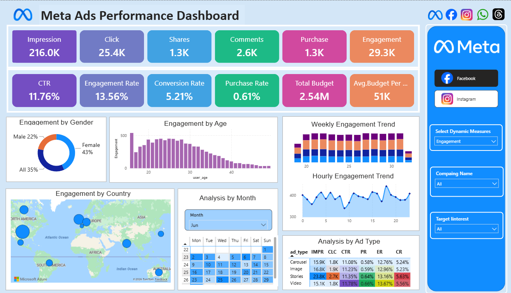

# 📊 Power BI Project: Facebook & Instagram Social Media Analysis
  
<em>Interactive Power BI Dashboard for Facebook & Instagram Performance Analysis</em>

---

## 📌 Project Overview

This is my **first end-to-end Power BI project**, developed to analyze Facebook and Instagram advertising performance and transform raw social media data into actionable business insights.

The project demonstrates the complete Power BI workflow, including data preparation, data modeling, DAX calculations, KPI development, and interactive dashboard design.

The dashboard helps stakeholders understand audience engagement, campaign effectiveness, conversion performance, and opportunities for optimization.

---

## 🎯 Business Objective

The goal of this project was to:

* Analyze Facebook and Instagram advertising performance
* Monitor key marketing KPIs
* Identify high-performing audience segments
* Evaluate campaign effectiveness
* Support data-driven marketing decisions

---

## 🛠️ Tools & Technologies

| Tool             | Purpose                               |
| ---------------- | ------------------------------------- |
| Power BI Desktop | Dashboard Development & Visualization |
| Power Query      | Data Cleaning & Transformation        |
| DAX              | Calculated Measures & KPIs            |
| Excel / CSV      | Data Source                           |
| Data Modeling    | Relationship Management & Star Schema |

---

## 📈 Dashboard Features

### KPI Metrics

* Total Impressions
* Total Clicks
* Total Engagements
* CTR (Click Through Rate)
* Engagement Rate
* Conversion Rate
* Purchase Rate
* Total Budget
* Average Budget per Campaign

### Interactive Visualizations

* Engagement Breakdown by Gender
* Engagement Analysis by Age Group
* Geographic Performance Analysis
* Weekly Engagement Trends
* Hourly Engagement Trends
* Calendar Heatmap Analysis
* Ad Type Performance Comparison
* Campaign Performance Monitoring

### Dynamic Filters

* Date Selection
* Campaign Filters
* Platform Filters
* Audience Segmentation

---

## 📊 Key Insights

### Performance Summary

| Metric          | Value  |
| --------------- | ------ |
| Impressions     | 216K   |
| Clicks          | 25.4K  |
| Engagements     | 29K    |
| Purchases       | 1.3K   |
| CTR             | 11.76% |
| Engagement Rate | 13.56% |
| Conversion Rate | 5.21%  |
| Purchase Rate   | 0.61%  |
| Total Budget    | 2.5M   |

### Key Findings

✅ Strong visibility and audience engagement

✅ CTR significantly exceeds industry averages

✅ Content resonates well with users

✅ Purchase funnel requires optimization

✅ High engagement does not fully translate into conversions

---

## 👥 Audience Analysis

### Gender Performance

* Female: 43%
* Male: 22%
* Other/Not Specified: 35%

**Insight:** Female audiences demonstrate the highest engagement levels.

### Age Analysis

* Highest engagement from ages **20–30**
* Engagement declines significantly after age 35

**Insight:** Young adults represent the most valuable audience segment.

---

## Geographic Analysis

Top performing countries:

* United States
* India
* Brazil
* Germany
* United Kingdom

### Recommendations

* Focus scaling campaigns in India and the United States
* Run premium conversion campaigns in Germany and the United Kingdom

---

## ⏰ Time-Based Analysis

### Weekly Trends

* Engagement remains stable throughout the campaign period

### Hourly Trends

Peak engagement occurs between:

* 15:00 – 20:00

Lowest engagement occurs between:

* 00:00 – 05:00

**Recommendation:** Schedule campaigns during afternoon and evening hours.

---

## 🎥 Ad Format Performance

| Ad Type  | Impressions | Clicks | CTR   | Purchase Rate | Conversion Rate | Engagement Rate |
| -------- | ----------- | ------ | ----- | ------------- | --------------- | --------------- |
| Carousel | 48K         | 6K     | 11.7% | 0.59%         | 5.1%            | 13.4%           |
| Image    | 51K         | 6K     | 11.7% | 0.57%         | 4.9%            | 13.5%           |
| Stories  | 72K         | 8K     | 11.8% | 0.65%         | 5.2%            | 13.6%           |
| Video    | 46K         | 5K     | 11.9% | 0.62%         | 5.2%            | 13.7%           |

### Insights

* Video Ads deliver the highest overall performance.

* Story Ads generate the highest volume of impressions.

* Carousel and Image Ads perform consistently but produce slightly lower conversion efficiency.

---

##  Recommendations

1. Improve landing page experience to increase conversions.
2. Prioritize female audiences aged 18–30.
3. Allocate more budget to Video and Story ads.
4. Schedule campaigns during peak engagement hours.
5. Focus spending on high-performing regions.
6. Implement retargeting campaigns to improve purchase rates.

---

##  What I Learned

As my first Power BI project, this experience helped me develop practical skills in:

* Data Cleaning using Power Query
* Data Modeling and Star Schema Design
* DAX Measures and Calculated Columns
* KPI Development
* Interactive Dashboard Design
* Data Storytelling
* Business Intelligence Reporting

This project significantly improved my understanding of how analytics can support business decision-making.

---
##  Dashboard 

## Author
Hamza Charrad

Aspiring Data Analyst | Machine Learning Enthusiast

LinkedIn:
[https://www.linkedin.com/in/hamza-charrad/]  

If you found this project useful, consider giving the repository a **Star ⭐**.

Your support is greatly appreciated!
